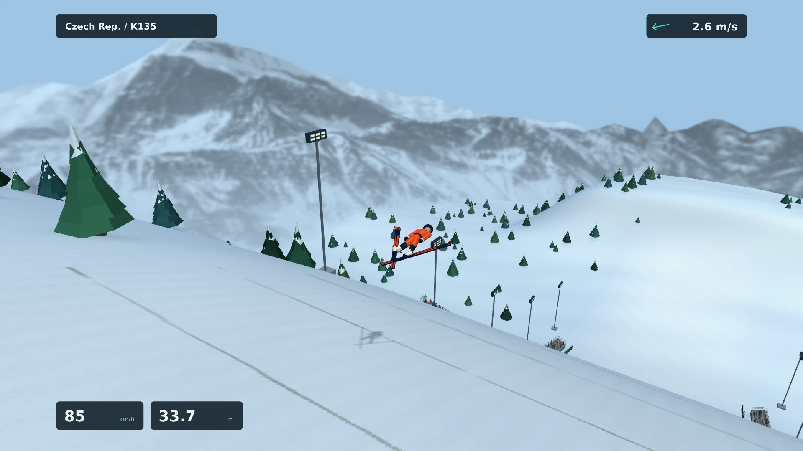
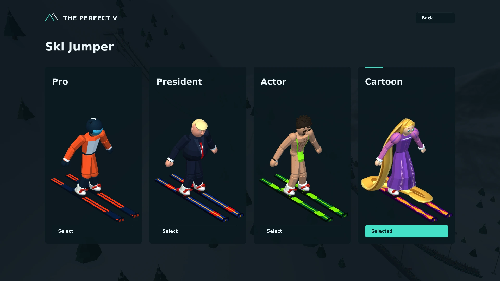
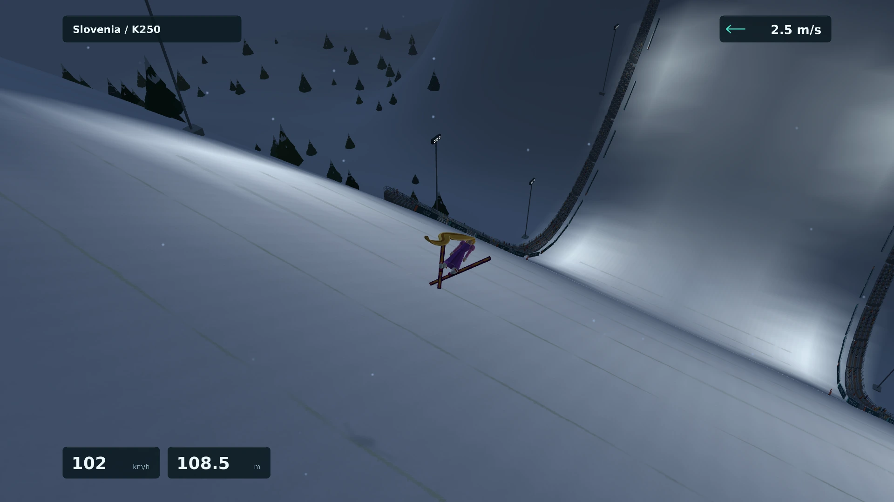

# The Perfect V

A native Linux, Windows and macOS ski jumping game with 32 hills, local competitions and four distinct
jumpers. Built with C++17, SDL3 and Vulkan.



## Features

- **32 hills**, from small practice venues to ski flying.
- **Practice, World Cup and Team Cup**, with local players and CPU opponents.
- **Four jumpers:** Pro, President, Actor and Cartoon. Different looks, identical physics.
- **Changing conditions:** morning, day, evening and night, with clear skies, clouds, snow or fog.
- **Replays, personal records and resumable cups.**

## Get started

Download the package for your system from [Releases](https://github.com/chl84/The-Perfect-V/releases).
Development builds are also available under **Actions**.

### Windows

The portable ZIP targets **Windows 10 (1903+) and Windows 11, 64-bit**. Extract the entire archive and
start `ThePerfectV/the-perfect-v.exe`. Keep the included assets and SDL3.dll beside
the executable. A working Vulkan graphics driver is required; no separate SDL,
FreeType or Visual C++ runtime installation is needed.

### macOS

The universal ZIP targets **macOS 12 or newer** on **Apple Silicon and Intel**,
with a Metal-capable GPU. Extract it and move **The Perfect V.app** to Applications.
SDL3, FreeType and MoltenVK (Vulkan over Metal) are included; Homebrew and the
Vulkan SDK are not required.

The app has an ad-hoc signature and is **not Apple notarized**. macOS may block
the first launch. After attempting to open it, use **System Settings → Privacy
& Security → Open Anyway** if you trust the download.

### Linux

The AppImage targets **x86_64 Linux with glibc 2.35 or newer**, including Ubuntu
22.04 and newer. A graphical desktop, a working Vulkan loader and a compatible
GPU driver are required. SDL3, FreeType and the window-system libraries are
bundled; system graphics drivers and audio services stay on the host.

To run the AppImage:

```sh
chmod +x ./ThePerfectV-*.AppImage
./ThePerfectV-*.AppImage
```

The runtime does not require a separate libfuse2 installation. If FUSE mounting
is unavailable, start with `--appimage-extract-and-run` instead. The game uses
the same save folder as a native installation.

### Build from source

Install a C++17 compiler, CMake 3.16 or newer, pkg-config, the SDL3 and FreeType
development packages, and either `glslc` (shaderc) or `glslangValidator`. Then:

```sh
git clone https://github.com/chl84/The-Perfect-V.git
cd The-Perfect-V
cmake -S . -B build-vulkan -DCMAKE_BUILD_TYPE=Release
cmake --build build-vulkan --parallel 4
./play-vulkan.sh
```

## How to jump

Start with **Practice** on England K50 or Austria K70. The in-game guide is under
**Settings → Controls**.

| Action | Mouse | Keyboard |
| --- | --- | --- |
| Leave the gate | Hold left button | Space |
| Take off | Hold both buttons near the board, then release | Space |
| Adjust flying position | Gentle vertical movement | Up / Down or W / S |
| Telemark landing | One button, then the other before contact | T |
| Two-foot landing | Both buttons together | B or Space in flight |
| Pause / resume | — | Esc |

Release the start button during the inrun. Time the takeoff near the end of the
ramp, then release both buttons before preparing your landing.

**Shortcuts:** C changes camera, G toggles the ghost during a jump, M toggles sound,
F11 toggles fullscreen, and R opens the replay from the menu or results.

## Choose your jumper

Select **Ski Jumper** from the main menu. Each character has its own appearance
and ski design; your choice never changes jump performance or scoring.



## Replays and saves

Replays support pause, timeline seeking, three cameras and 0.25×–2× playback.
**PVR** preserves the jump, character, time of day and weather. Original DSJ
**RPL** files can also be opened, and exported when the recording supports it.
Hover over the export buttons for a short explanation. Open a replay through
**Replays**, drop it onto the window, or use `./play-vulkan.sh --replay FILE`
or pass `--replay FILE` to the executable or AppImage. On macOS, files can also
be dropped onto the running game window.



The default save folder is `~/.local/share/the-perfect-v/saves/` on Linux (respecting
`XDG_DATA_HOME`), `%APPDATA%/the-perfect-v/saves/` on Windows, and
`~/Library/Application Support/the-perfect-v/saves/` on macOS.
It holds settings, records, cups and replays. Interrupted cups
can be resumed; resource updates leave saves intact. Use `--data-dir PATH` for
a separate save folder. Personal saves and replays are excluded from Git.

## Development

```sh
ctest --test-dir build-vulkan --output-on-failure
```

**GitHub Actions** builds the AppImage on Ubuntu 22.04 with GCC 11, runs the test
suites and the packaged game's Vulkan smoke test, and checks startup on clean
Ubuntu 22.04 and 24.04 runners. Successful builds provide the AppImage, SHA-256
checksum and a dependency/baseline report. No release is published automatically.
The pinned build recipe is in [package-appimage.sh](package-appimage.sh);
`package.sh` runs the same recipe on a suitably prepared Ubuntu 22.04 system.
Linux has no separate tar/zip game package.

The **Windows** workflow builds a portable ZIP with MSVC and source-built SDL3 and
FreeType. It runs the standalone suites and tests the extracted package on a fresh
Windows runner with software Vulkan, including paths with spaces and Unicode.
The Windows ZIP includes project and dependency sources under `docs/source/`.

The **macOS** workflow builds one universal app with Apple Clang, pinned SDL3,
FreeType and MoltenVK. Standalone tests run natively on Apple Silicon and Intel;
the extracted app is checked on fresh runners in paths with spaces and Unicode.
Graphics smoke tests run only when the runner exposes a Metal GPU; a missing
GPU is explicitly reported as untested. Project and SDL3/FreeType sources are
included under `Contents/Resources/docs/source/` in the app.

The matching project source and SDL source are embedded in the AppImage. Export
the project source with `./ThePerfectV-*.AppImage --export-source source.tar.gz`.
See [development notes](docs/DEVELOPMENT.md) for diagnostics and build details.

## License and credits

Copyright (C) 2026 chl84 and contributors. Original code, documentation and
resources are licensed under [GPL-3.0-only](LICENSE), without warranty.
Third-party resources retain their own terms:
[fonts](assets/fonts/LICENSE-DejaVu.txt), [audio](assets/audio/CREDITS.md),
[mountain panorama](assets/environment/CREDITS.md) and [flags](assets/flags/CREDITS.md).

The hills and gameplay rules are reconstructed from Deluxe Ski Jump 2.10.
Original game files are neither included nor required. Deluxe Ski Jump belongs
to its original author; this project's license grants no rights to that game.
